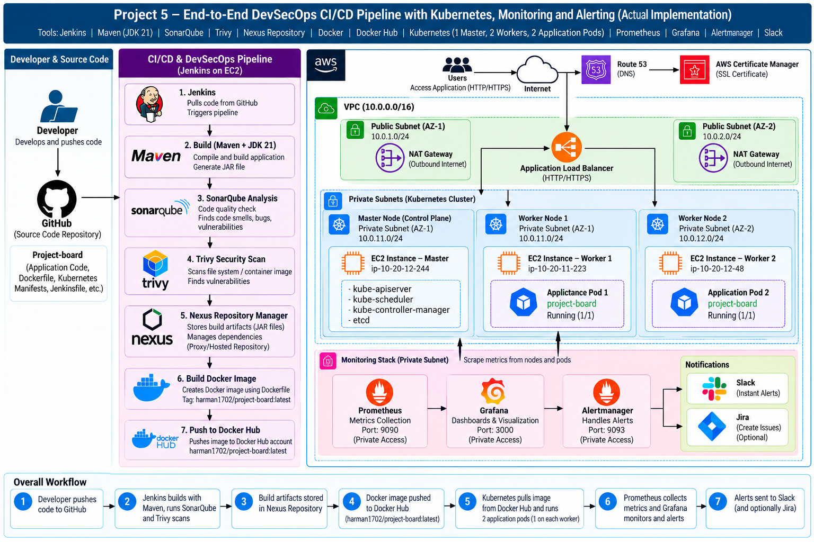
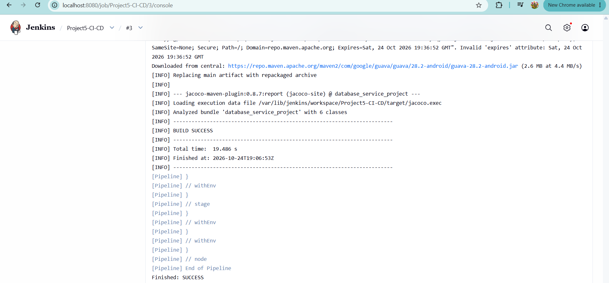
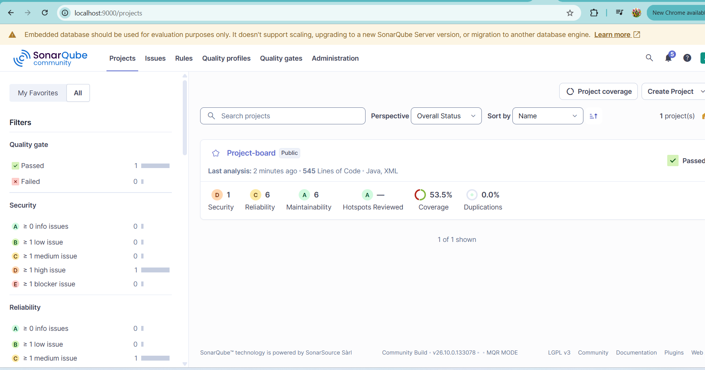
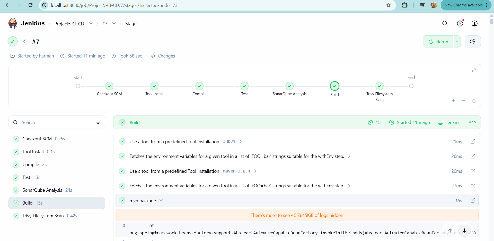
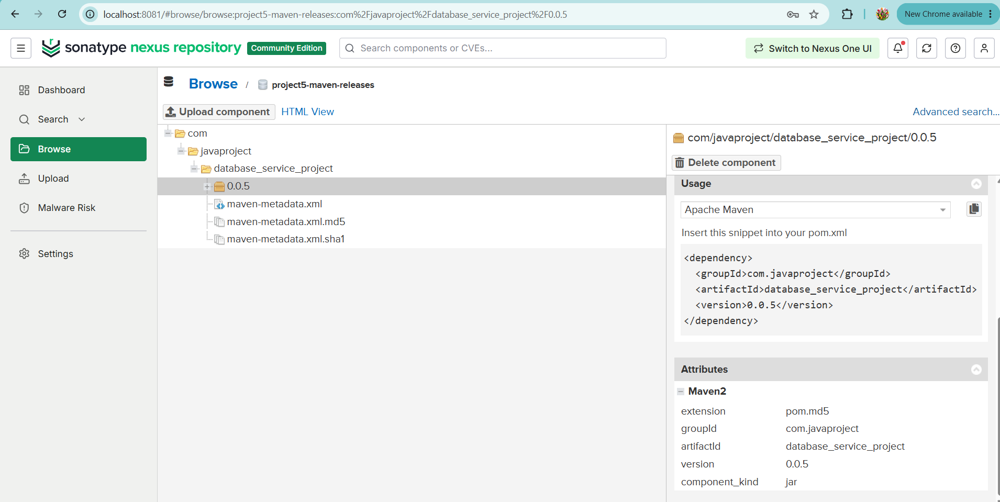
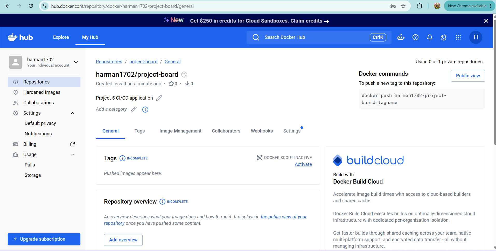
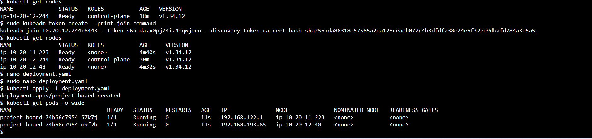
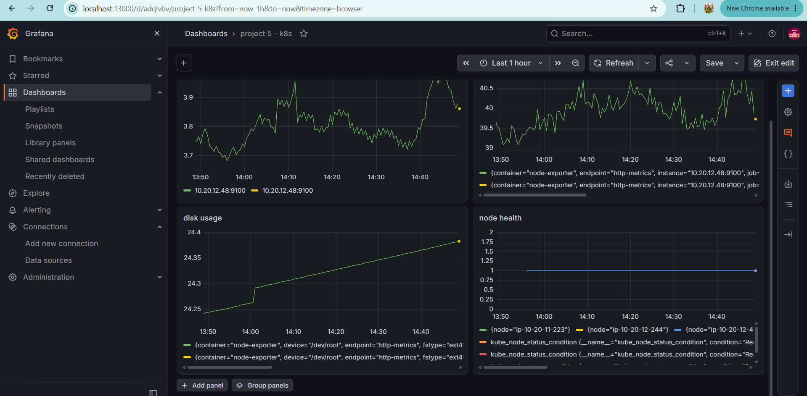
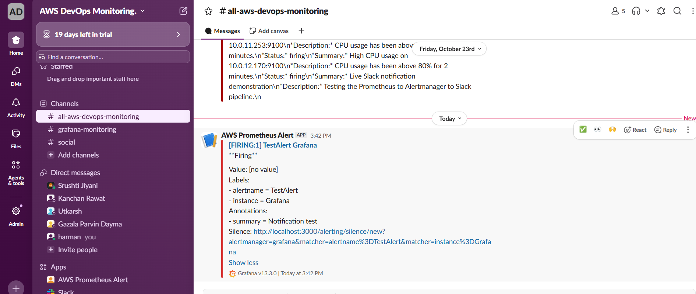

# Project 5: End-to-End DevSecOps CI/CD Pipeline with Kubernetes Monitoring

## 1. Project Overview

This project demonstrates an end-to-end DevSecOps workflow for building, scanning, containerizing, deploying, and monitoring a Java-based Boardgame Listing Web Application.

The project integrates CI/CD automation, code-quality analysis, security scanning, artifact management, container image storage, Kubernetes orchestration, infrastructure hosted on AWS EC2, and monitoring with Slack notifications.

## 2. Application Description

The Boardgame Listing Web Application is a full-stack web application that displays board games and their reviews.

- Non-members can view board games and reviews.
- Users can add board games and write reviews.
- Managers can edit and delete reviews.

The application uses role-based authentication and authorization with Spring Security.

## 3. Architecture

The architecture represents the application delivery pipeline and the monitoring workflow deployed using AWS EC2 and a self-managed Kubernetes cluster.

## 4. Technology Stack

| Category | Technologies |
|---|---|
| Cloud infrastructure | AWS EC2 |
| Source code management | GitHub |
| CI/CD automation | Jenkins |
| Build tools | Maven, JDK 21 |
| Code-quality analysis | SonarQube |
| Security scanning | Trivy |
| Artifact management | Nexus Repository Manager |
| Containerization | Docker |
| Container image registry | Docker Hub |
| Container orchestration | Kubernetes using kubeadm |
| Monitoring and metrics | Prometheus |
| Dashboards and alerting | Grafana |
| Notifications | Slack |
| Application framework | Java, Spring Boot, Spring MVC |
| Frontend | Thymeleaf, HTML5, CSS, JavaScript, Bootstrap |
| Application data | H2 in-memory database, as described in the original application documentation |
| Testing | JUnit |

## 5. DevSecOps CI/CD Workflow

1. **Source code management:** Application code and pipeline files are maintained in GitHub.
2. **Continuous integration:** Jenkins automates the configured pipeline stages.
3. **Build:** Maven and JDK 21 are used to build the Java application.
4. **Code-quality analysis:** SonarQube analyzes code quality.
5. **Security scanning:** Trivy scans the configured files or container images for vulnerabilities.
6. **Artifact management:** Nexus Repository Manager is used for artifact and dependency management.
7. **Containerization:** Docker builds the application container image.
8. **Image registry:** The application image is pushed to Docker Hub.
9. **Deployment:** Kubernetes pulls the image and runs the application pods.
10. **Monitoring and alerting:** Prometheus collects metrics, Grafana provides dashboards and alerting, and Slack receives notifications.

## 6. Kubernetes Deployment

The application was deployed to a self-managed Kubernetes cluster running on AWS EC2 instances.

The verified cluster snapshot showed:

- 1 Kubernetes control-plane (master) node
- 2 Kubernetes worker nodes
- 2 running `project-board` application pods
- 1 application pod running on each worker node

Kubernetes was installed using kubeadm. Amazon EKS was not used.

## 7. Docker Hub

The application container image was pushed to Docker Hub.

- **Docker Hub repository:** `harman1702/project-board`
- **Image tag:** `latest`
- **Image reference:** `harman1702/project-board:latest`

## 8. Monitoring and Alerting

Prometheus and Grafana were configured for monitoring the Kubernetes environment.

The monitoring workflow includes:

- Prometheus metrics collection
- Grafana dashboards and alerting
- Slack notification integration

A Grafana test notification was successfully received in the `#all-aws-devops-monitoring` Slack channel.

## 9. Application Access

- **Application:** Boardgame Listing Web Application
- **Deployment platform:** Self-managed Kubernetes on AWS EC2
- **Application URL:** Add the verified application URL here.

The URL and availability depend on the configured application access method and whether the AWS resources are running.

## 10. Repository Contents

- `Jenkinsfile` — CI/CD pipeline definition
- `Dockerfile` — Container image build instructions
- `pom.xml` — Maven project and dependency configuration
- `deployment-service.yaml` — Kubernetes deployment and service configuration
- `sonar-project.properties` — SonarQube project configuration
- `src/` — Application source code
- `.trivyignore` — Trivy scan exclusions, if configured

Additional architecture diagrams, implementation documentation, and screenshots can be stored in the corresponding folders.
## 13. Project Implementation Screenshots

### Jenkins CI/CD Pipeline

### SonarQube Code Quality Analysis

### Trivy Security Scan

### Nexus Repository Manager

### Docker Hub Container Image

### Kubernetes Nodes and Application Pods

### Grafana Monitoring Dashboard

### Slack Alert Notification

## 11. Key Learning Outcomes

- CI/CD pipeline automation using Jenkins
- Java application builds using Maven
- Code-quality analysis using SonarQube
- Security scanning using Trivy
- Artifact management using Nexus Repository Manager
- Docker image creation and Docker Hub publishing
- Kubernetes deployment on self-managed EC2 instances
- Prometheus and Grafana monitoring
- Slack alert notification integration

## 12. Conclusion

This project demonstrates the integration of DevSecOps practices across application delivery, security scanning, container deployment, and monitoring. It provided practical experience with CI/CD automation, Kubernetes administration, AWS EC2 infrastructure, and monitoring notifications.

